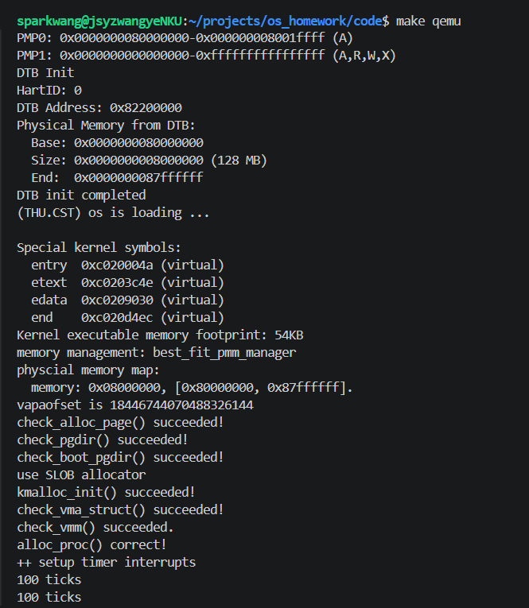

## 4.2 功能模块二：内核线程的创建与首次运行现场构造
本部分承接功能模块一（A 已完成的 `page_insert()` / `page_remove()` / `alloc_proc()`）所提供 PCB 约定和物理页管理接口，在 `kern/process/proc.c` 中实现进程模块的初始化与内核线程的创建：`proc_init()` 负责把当前执行流包装成 0 号内核线程 idleproc，并通过 `kernel_thread()` 创建执行 `init_main` 的 1 号内核线程 initproc；`do_fork()` 则组合 `setup_kstack`、`copy_mm`、`copy_thread` 完成新线程的资源构造与登记；`copy_thread()` 落成首次恢复所需的 `trapframe` 与 `context`。
### 4.2.1 idleproc 的建立与 initproc 的注册
**负责人：** 2411294-王烨。
```c
// kern/process/proc.c
void proc_init(void);
```
**规格设计：** 函数无输入输出。执行前先对 `proc_list` 与 `hash_list[HASH_LIST_SIZE]` 完成链表初始化，这是后续 `list_add` / `hash_proc` 能正常工作的前提。随后调用 A 已实现的 `alloc_proc()` 取得一个初值齐全的 PCB，将其升级为 0 号内核线程 idleproc：`pid=0`、`state=PROC_RUNNABLE`、`kstack=(uintptr_t)bootstack`（直接复用内核启动栈，不再单独分配）、`need_resched=1`（保证一进入 `cpu_idle` 就主动让出 CPU）、名字设为 `"idle"`，同时把全局 `current` 指向它，`nr_process++`。idleproc 不参与 `proc_list` 链表，是唯一仅靠 `current` / `idleproc` 指针引用的线程。之后调用 `kernel_thread(init_main, "Hello world!!", 0)` 创建 initproc；若返回 pid ≤ 0 则 `panic("create init_main failed.")`，否则用 `find_proc(pid)` 反查 PCB、把名字设为 `"init"`。函数末尾以两条断言回归检查 `idleproc->pid == 0` 与 `initproc->pid == 1`，覆盖 PID 分配和 hash 查找两条链路。
### 4.2.2 kernel_thread 与 do_fork：新线程的资源构造与登记
**负责人：** 2411294-王烨。
```c
// kern/process/proc.c
int kernel_thread(int (*fn)(void *), void *arg, uint32_t clone_flags);
int do_fork(uint32_t clone_flags, uintptr_t stack, struct trapframe *tf);
```
**规格设计：** `kernel_thread` 输入为函数指针 `fn`、参数 `arg` 与克隆标志 `clone_flags`，返回新线程 PID 或负错误码。函数先在栈上构造一个临时 `trapframe tf` 并清零，再把"线程首次被调度后将跳到哪里、用什么参数"编码进这份现场：`tf.gpr.s0 = fn`、`tf.gpr.s1 = arg`，`tf.status = (read_csr(sstatus) | SSTATUS_SPP | SSTATUS_SPIE) & ~SSTATUS_SIE`（保证 `sret` 后回到 S 模式、且中断使能状态由 SPIE 决定，避免首次切换时立刻被时钟中断打断），`tf.epc = kernel_thread_entry` 作为首次执行的入口。最后通过 `do_fork(clone_flags | CLONE_VM, 0, &tf)` 完成 fork：`CLONE_VM` 表示与父线程共享地址空间，`stack=0` 让 `copy_thread` 用 `proc->tf` 自身地址作为子线程的初始 sp。
关键代码为：
```c
int
do_fork(uint32_t clone_flags, uintptr_t stack, struct trapframe *tf) {
    int ret = -E_NO_FREE_PROC;
    struct proc_struct *proc;
    if (nr_process >= MAX_PROCESS) {
        goto fork_out;
    }
    ret = -E_NO_MEM;
    if ((proc = alloc_proc()) == NULL) {
        goto fork_out;
    }
    proc->parent = current;
    if (setup_kstack(proc) != 0) {
        goto bad_fork_cleanup_proc;
    }
    if (copy_mm(clone_flags, proc) != 0) {
        goto bad_fork_cleanup_kstack;
    }
    copy_thread(proc, stack, tf);
    bool intr_flag;
    local_intr_save(intr_flag);
    {
        proc->pid = get_pid();
        hash_proc(proc);
        list_add(&proc_list, &(proc->list_link));
        nr_process ++;
    }
    local_intr_restore(intr_flag);
    wakeup_proc(proc);
    ret = proc->pid;
fork_out:
    return ret;
bad_fork_cleanup_kstack:
    put_kstack(proc);
bad_fork_cleanup_proc:
    kfree(proc);
    goto fork_out;
}
```
清理链的顺序严格与获取顺序相反：`setup_kstack` 失败只需 `kfree(proc)`；`copy_mm` 失败则需先 `put_kstack(proc)` 再 `kfree(proc)`；`copy_thread` 之后不再有失败分支，登记段在关中断下原子完成，因此不会出现"已在 proc_list 上却因后续失败被释放"的悬挂节点。
`copy_mm` 在本实验中作为占位实现保留完整形态：以 `assert(current->mm == NULL)` 限定 lab4 阶段只服务内核线程，`clone_flags & CLONE_VM` 成立时直接共享父进程的 `mm` 并 `mm_count_inc`，否则才走真正的复制路径。
### 4.2.3 copy_thread：落成"首次恢复"所需的 Trapframe 与 Context
**负责人：** 2411294-王烨。
```c
// kern/process/proc.c
static void copy_thread(struct proc_struct *proc, uintptr_t esp, struct trapframe *tf);
```
**规格设计：** 输入为已完成 `setup_kstack` 的 PCB、目标栈顶 `esp`（内核线程传 0）、父进程临时 `trapframe tf`。函数把子线程的中断帧固定放在其内核栈顶端：`proc->tf = (struct trapframe *)(proc->kstack + KSTACKSIZE - sizeof(struct trapframe))`，再通过 `*(proc->tf) = *tf` 把 `kernel_thread` 准备好的现场整体复制过去。随后做两处子线程特有修正：`tf->gpr.a0 = 0` 让子进程首次"返回值"为 0，与 `fork` 语义对应；`tf->gpr.sp` 取 `esp==0 ? (uintptr_t)proc->tf : esp`，即内核线程把中断帧自身地址作为栈顶。最后写两个切换字段：`proc->context.ra = (uintptr_t)forkret`（线程被 `switch_to` 切入后第一条指令入口）与 `proc->context.sp = (uintptr_t)proc->tf`（让 `forkret` 能立即通过 `forkrets(current->tf)` 跳到 `__trapret` 完成首次现场恢复）。
关键代码为：
```c
static void
copy_thread(struct proc_struct *proc, uintptr_t esp, struct trapframe *tf) {
    proc->tf = (struct trapframe *)(proc->kstack + KSTACKSIZE
                                    - sizeof(struct trapframe));
    *(proc->tf) = *tf;
    // Set a0 to 0 so a child process knows it's just forked
    proc->tf->gpr.a0 = 0;
    proc->tf->gpr.sp = (esp == 0) ? (uintptr_t)proc->tf : esp;
    proc->context.ra = (uintptr_t)forkret;
    proc->context.sp = (uintptr_t)(proc->tf);
}
```

**最终提示词：**
```text
[PROMPT] 在 kern/process/proc.c 完成 proc_init、kernel_thread、do_fork、
copy_mm、copy_thread，学号 2411294 王烨。
仅完成本人负责的进程创建与首次运行现场构造部分，
不修改 A 已交付的 alloc_proc 与 page_insert/page_remove，不实现 C 的
cpu_idle/schedule/proc_run/switch_to。
[RELY] 读取 proc.h 中 proc_struct / context / trapframe 的字段约定，
以 A 已实现的 alloc_proc（pgdir 指向 boot 页表物理地址、其余字段清零）
与 alloc_pages/free_pages/page2kva 接口为唯一分配来源，
以框架的 kernel_thread_entry、forkret、forkrets、__trapret 为切换终点。
[GUARANTEE] proc_init 先 list_init(proc_list) 与 hash_list 再创建线程；
idleproc 复用 bootstack、need_resched=1、current=idleproc、nr_process++；
initproc 通过 kernel_thread 创建，失败时 panic("create init_main failed.")，
成功后 find_proc(pid) 反查并命名 "init"，末尾 assert idleproc->pid==0
且 initproc->pid==1。
[SPECIFICATION] kernel_thread 把 fn/arg 写入 s0/s1，
tf.status=(sstatus|SPP|SPIE)&~SIE，tf.epc=kernel_thread_entry，
经 do_fork(clone_flags|CLONE_VM,0,&tf) 进入 fork 流程；
do_fork 按 alloc_proc→setup_kstack→copy_mm→copy_thread→关中断段
(get_pid+hash_proc+list_add+nr_process++)→wakeup_proc 顺序推进，
失败沿 bad_fork_cleanup_* 反向释放；copy_mm 在 CLONE_VM 时共享 mm 并
mm_count_inc；copy_thread 把 tf 置于 kstack+KSTACKSIZE-sizeof(trapframe)、
a0=0、sp=proc->tf、context.ra=forkret、context.sp=proc->tf。
通过 make qemu 验证 alloc_proc() correct! 之后无 panic、无 assert 失败，
initproc 已就绪挂入 proc_list，等待功能模块三接管调度。
```
---
## 4.3 B 部分验收：`make qemu` 运行核对
按上述实现构建后运行 `make qemu`，得到的验收截图如下，可作为本模块的运行证据：

将截图逐段与模块契约对齐：
**A 的接口已被正确衔接。** 截图末段连续打印 `check_vma_struct() succeeded!`、`check_vmm() succeeded.`、`alloc_proc() correct!`，说明 `proc_init` 调用 A 实现的 `alloc_proc` 后其内置 memcmp 通过`state=PROC_UNINIT`、`pid=-1`、`kstack=0`、`tf=NULL`、`mm=NULL`、`pgdir=boot_pgdir_pa`、`context` 与 `name` 全零的初值约定完全成立。
**B 模块正向路径无任何 panic。** `alloc_proc() correct!` 之后紧接 `++ setup timer interrupts`，意味着 `proc_init` 内的两条 `assert(idleproc->pid==0 && initproc->pid==1)` 与 `assert(initproc != NULL)` 全部通过——反推出 `kernel_thread → do_fork → setup_kstack → copy_mm → copy_thread → get_pid → hash_proc → list_add → wakeup_proc` 全链未触发 `panic("create init_main failed.")`，也未触发任何 `bad_fork_cleanup_*` 失败分支。
