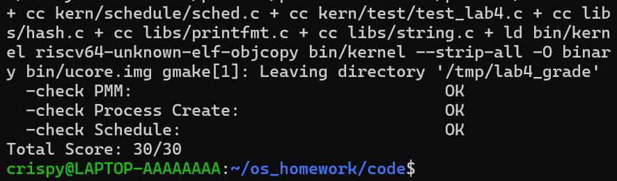
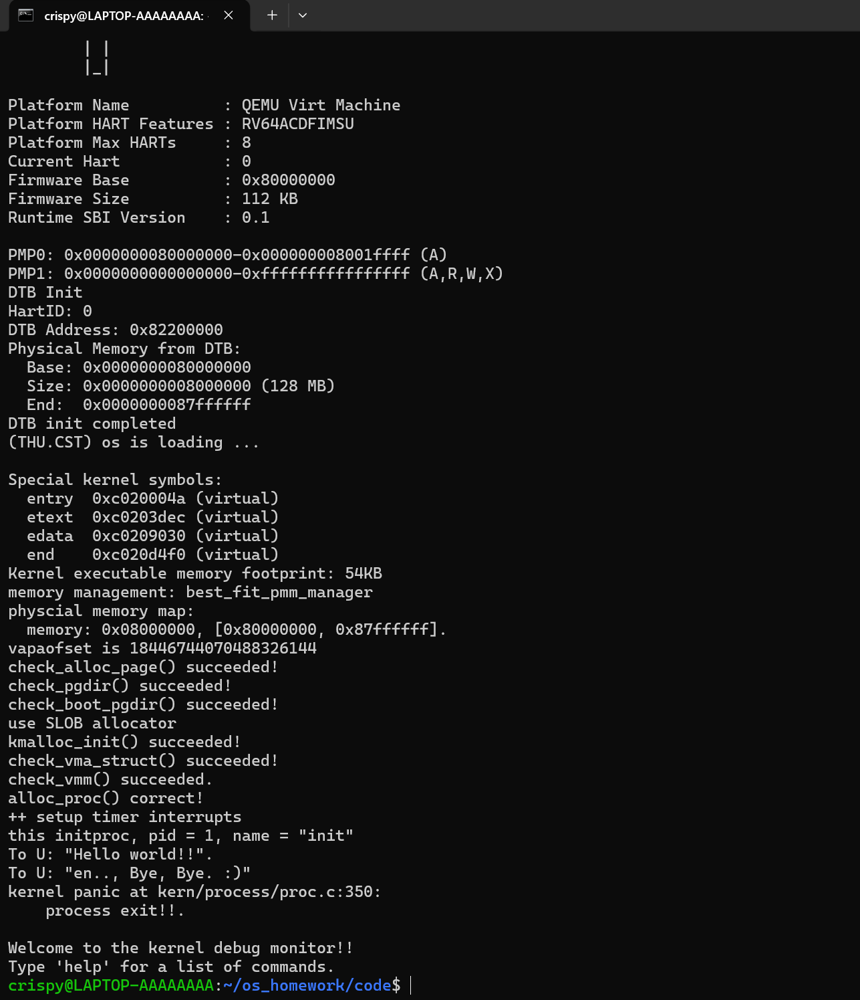

## 4.3 功能模块三：进程调度与上下文切换

**负责人：** 2411276-林靖然

本部分承接功能模块二构造好的首次运行现场，在 `kern/process/proc.c`、`kern/schedule/sched.c`、`kern/process/switch.S` 中实现 `cpu_idle()`、`schedule()`、`proc_run()`、`switch_to()`，让已经创建出来的内核线程真正被 CPU 执行；同时负责打通 `switch_to → forkret → forkrets → __trapret → kernel_thread_entry` 这条首次执行链路。

### 4.3.1 整体逻辑线

本节处于整个 lab4 执行链的后半段：

```
kern_init
  → pmm_init          物理内存管理
  → pic_init/idt_init 中断
  → vmm_init          虚拟内存管理
  → proc_init         创建 idleproc 与 initproc
  → clock_init / intr_enable
  → cpu_idle          idleproc 开始空转，发现 need_resched 就调度
      → schedule      选出下一个就绪线程
      → proc_run      切换 current、页表和执行现场
      → switch_to     保存旧上下文、恢复新上下文
```

前面两个模块解决的是“地址空间准备好了没有”和“线程对象造出来了没有”，本模块解决的是“让线程真正跑起来”。本实验的调度点唯一位于 `cpu_idle()` 中，属于协作式调度。

### 4.3.2 cpu_idle：空闲线程的执行主体

**函数：** `void cpu_idle(void);`（`kern/process/proc.c`）

**设计：** 函数不返回。`proc_init()` 把 `idleproc->need_resched` 置为 1，因此一进入 `cpu_idle()` 就会调用 `schedule()` 让出 CPU；之后每次被调度回来，都重新检查 `need_resched`。没有就绪线程时，`schedule()` 会回退到 `idleproc`，循环继续。

关键代码：

```c
void cpu_idle(void)
{
    while (1)
    {
        if (current->need_resched)
        {
            schedule();
        }
    }
}
```

### 4.3.3 schedule：选择下一个就绪线程

**函数：** `void schedule(void);`（`kern/schedule/sched.c`）

**设计：** 在关中断临界区内完成选择。先把 `current->need_resched` 清零，然后从 `proc_list` 中找下一个处于 `PROC_RUNNABLE` 的线程：当前线程不是 `idleproc` 时，从 `current->list_link` 的下一个节点开始查找，形成轮转调度；当前线程是 `idleproc` 时，从链表头开始查找，保证所有线程机会均等；环形遍历一圈仍未找到，就回退 `idleproc` 保底。选中者 `runs` 加 1；如果选中者不是当前线程，再调用 `proc_run()` 完成切换。

关键代码：

```c
void schedule(void) {
    bool intr_flag;
    list_entry_t *le, *last;
    struct proc_struct *next = NULL;
    local_intr_save(intr_flag);
    {
        current->need_resched = 0;
        // 轮转调度：从当前线程的下一个位置开始查找；当前是 idleproc 时从链表头开始。
        last = (current == idleproc) ? &proc_list : &(current->list_link);
        le = last;
        do {
            if ((le = list_next(le)) != &proc_list) {
                next = le2proc(le, list_link);
                if (next->state == PROC_RUNNABLE) {
                    break;
                }
            }
        } while (le != last);
        // 找不到其他就绪线程时，回退到 idleproc 保底。
        if (next == NULL || next->state != PROC_RUNNABLE) {
            next = idleproc;
        }
        next->runs ++;
        if (next != current) {
            proc_run(next);
        }
    }
    local_intr_restore(intr_flag);
}
```

`do...while (le != last)` 的作用是保证环形遍历完整一圈：从 `last` 出发，走遍所有节点后回到 `last` 才结束，不会漏掉当前线程之前的节点。

### 4.3.4 proc_run：切换当前线程与地址空间

**函数：** `void proc_run(struct proc_struct *proc);`（`kern/process/proc.c`）

**设计：** 目标与当前线程相同时直接返回；否则在关中断临界区内依次完成：先保存旧线程指针并更新 `current`，再把新线程的页表基址写入 `satp`（Sv39 模式位 | `pgdir >> RISCV_PGSHIFT`），然后执行 `flush_tlb()`，调用 `switch_to(&prev->context, &current->context)`，最后恢复进入前的中断状态。

关键代码：

```c
void proc_run(struct proc_struct *proc)
{
    if (proc != current)
    {
        bool intr_flag;
        struct proc_struct *prev = current;
        local_intr_save(intr_flag);
        {
            current = proc;
            // pgdir 保存页表的物理地址（satp 写法参照 enable_paging）。
            write_csr(satp, 0x8000000000000000 | (proc->pgdir >> RISCV_PGSHIFT));
            flush_tlb();
            switch_to(&(prev->context), &(current->context));
        }
        local_intr_restore(intr_flag);
    }
}
```

关键点有三个。第一，为什么要关中断：`current`、`satp`、栈三者必须一起切换，被中断打断会出现“current 已是新线程、页表还是旧的”的半切换状态。第二，为什么要写 `satp`：`pgdir` 是页表根节点的物理地址，CPU 通过 `satp` 找到当前页表；`libs/riscv.h` 里的 `lsatp()` 是 Sv32 遗留写法，无法表达 Sv39，因此参照 `enable_paging()` 的写法。第三，为什么要刷 TLB：页表根变了，旧的地址翻译缓存必须失效。

### 4.3.5 switch_to：最底层的上下文切换

**函数：** `void switch_to(struct context *from, struct context *to);`（`kern/process/switch.S`）

**设计：** 只保存和恢复被调用者保存寄存器，寄存器布局严格对应 `struct context`：

```
偏移  0: ra      8: sp     16: s0   24: s1   32: s2   40: s3
      48: s4    56: s5     64: s6   72: s7   80: s8   88: s9
      96: s10  104: s11
```

关键代码：

```asm
.globl switch_to
switch_to:
    sd ra,   0(a0)
    sd sp,   8(a0)
    sd s0,  16(a0)
    ...
    sd s11, 104(a0)

    ld ra,   0(a1)
    ld sp,   8(a1)
    ld s0,  16(a1)
    ...
    ld s11, 104(a1)

    ret
```

为什么只保存 14 个寄存器：线程切换发生在函数调用内部，编译器会负责保存调用者保存寄存器，我们只需要保存被调用者保存寄存器。`a0/a1` 是参数寄存器，不参与保存。`ret` 返回到 `to->ra`，对于新线程就是 `forkret`。

### 4.3.6 最终提示词

完整提示词见 `report/prompt.md` 中“功能模块三”。

## 4.4 中断开关思考题

**题目：** 说明语句 `local_intr_save(intr_flag); ... local_intr_restore(intr_flag);` 是如何实现开关中断的。

实现位于 `kern/sync/sync.h`：

```c
static inline bool __intr_save(void) {
    if (read_csr(sstatus) & SSTATUS_SIE) {
        intr_disable();
        return 1;
    }
    return 0;
}

static inline void __intr_restore(bool flag) {
    if (flag) {
        intr_enable();
    }
}

#define local_intr_save(x)    do { x = __intr_save(); } while (0)
#define local_intr_restore(x) __intr_restore(x);
```

`intr_disable()` 通过 `clear_csr(sstatus, SSTATUS_SIE)` 清除 S 模式全局中断使能位，`intr_enable()` 通过 `set_csr` 置位。

关键设计是保存旧状态：`__intr_save()` 在关中断前先读 `SSTATUS_SIE`，把“原来是否开启”存入 `intr_flag`；`__intr_restore()` 只在原来开启时才重新开中断。这样支持嵌套：外层已经关中断时，内层 save 返回 0，内层 restore 什么也不做，不会提前打开外层的临界区。

`proc_run()` 和 `schedule()` 都使用这一机制，保证“修改 current、切换 satp、切换栈”以及“遍历并修改进程链表”这些操作在单核上原子完成。

## 4.5 分页模式思考题

**题目：** 结合 Sv32、Sv39、Sv48 的异同，解释 `get_pte()` 中两段相似的代码为什么如此相像；并讨论把页表项查找和页表页分配合并在一个函数里是否合适。

### 4.5.1 三种分页模式的异同

| 模式 | 虚拟地址位数 | 页表级数 | 地址切分 | 页表项大小 | 单级页表项数 | 可寻址空间 |
|---|---|---|---|---|---|---|
| Sv32 | 32 | 2 | 10 + 10 + 12 | 4 字节 | 1024 | 4 GB |
| Sv39 | 39 | 3 | 9 + 9 + 9 + 12 | 8 字节 | 512 | 512 GB |
| Sv48 | 48 | 4 | 9 + 9 + 9 + 9 + 12 | 8 字节 | 512 | 256 TB |

共同点：地址都按“页内偏移 + 若干级虚拟页号”切分；每一级都用一段虚拟页号作为索引，去一张页表里取出下一级页表的物理地址；最后一级页表项存目标物理页号和权限位；三种模式都支持大页（Sv32 的 4 MB megapage，Sv39/Sv48 的 2 MB、1 GB 大页）。

差异点：Sv32 用 10 位索引、4 字节页表项，Sv39/Sv48 用 9 位索引、8 字节页表项，因为物理页号字段更宽；Sv32 两级、Sv39 三级、Sv48 四级；可寻址的虚拟地址空间大小也随位数不同。

### 4.5.2 两段代码为什么相像

`get_pte()` 的第一段处理 `PDX1(la)`，完成“根页表 → 二级页表”；第二段处理 `PDX0(la)`，完成“二级页表 → 三级页表”。两段做的是同一件事：用当前级的索引取出页表项；页表项无效且 `create` 为真时，分配一页、清零、设置引用计数为 1、把页号写进上一级；最后通过 `KADDR` 把下一级页表的物理地址转成内核虚拟地址，继续往下走。

区别在于用哪个索引宏和处在第几级。跨分页模式看也是一样：页表遍历本身是同构的过程，Sv32 只是索引位数不同、级数少一级，Sv48 则是再加一级。如果把每一级的位移和掩码放进数组，用一个循环实现，同一套代码就能支持 Sv32/Sv39/Sv48。ucore 固定按 Sv39 展开写成两段，是为了和 `PDX1/PDX0/PTX` 宏以及三级页表布局一一对应，读起来更直观。

### 4.5.3 查找与分配是否应该拆开

合并写法的好处：调用方只面对一个接口，`page_insert()` 建映射时不需要先查再建；`create` 参数把只查和查并建统一起来，`get_page()`、`page_remove()` 传 0 即可；也不用维护两套遍历逻辑。

缺点：一个函数承担两件事，职责不单一；只读路径必须记得传 `create=0`，否则会悄悄分配页表；中途失败要回滚本次已建的中间页表（`get_pte()` 里撤销 `new_table` 的逻辑就是代价），容易遗漏；查找和分配也难以分别测试。

是否有必要拆开：`create` 的含义写清楚、失败回滚没有漏，其实也没有必要拆开，当然拆开写也可以，一个函数只负责找到页表项，不分配任何东西，另一个函数负责在需要时分配中间的页表页。

## 4.6 整体验收

执行 `make grade`，三项测试全部通过：



执行 `make qemu`：



关键输出：

```text
this initproc, pid = 1, name = "init"
To U: "Hello world!!".
To U: "en.., Bye, Bye. :)"
```
