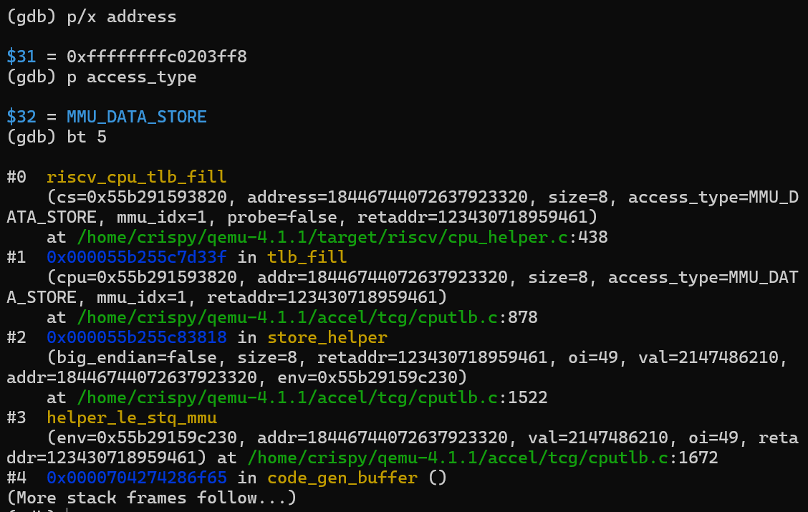
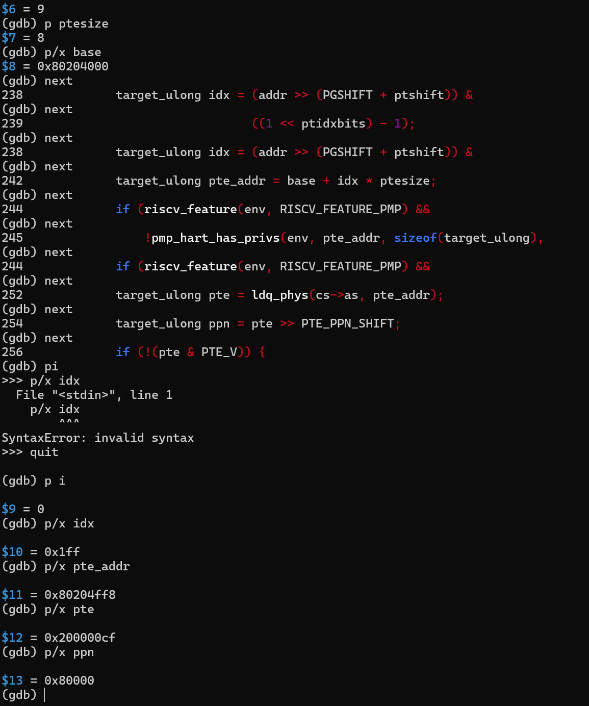
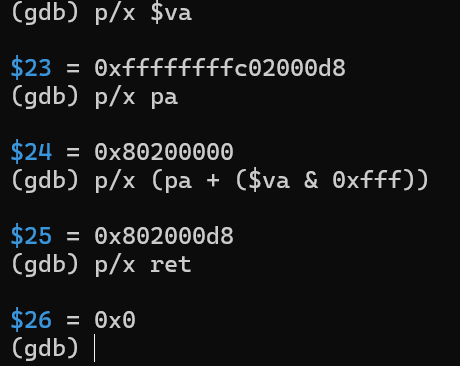
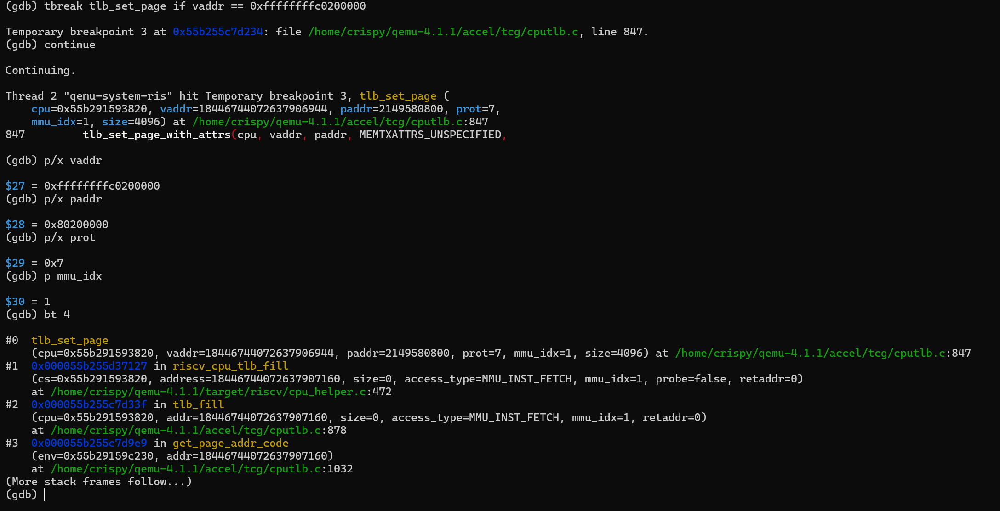
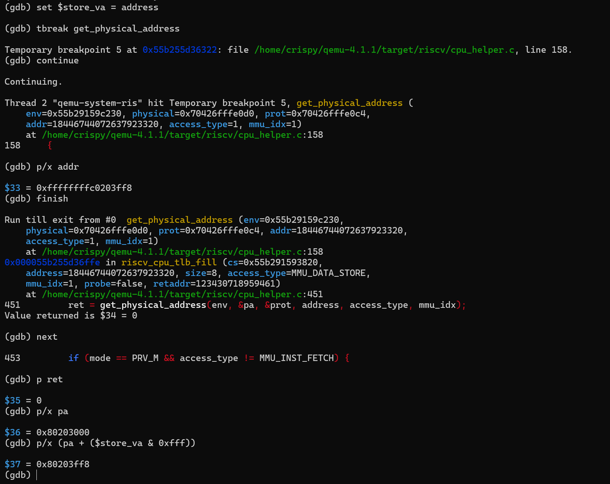
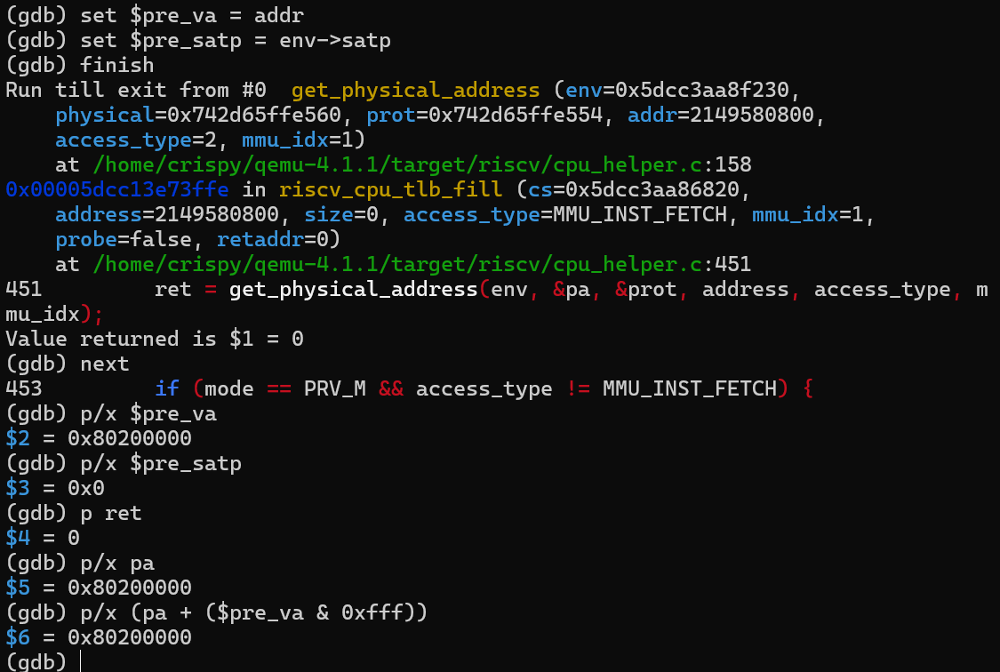

# 操作系统实验报告

## 实验基本信息

| 项目 | 内容 |
|------|------|
| 实验名称 | Lab 2：物理内存管理 |
| 小组成员 | 2411795-阎科霖、2411294-王烨、2411276-林靖然 |
| 完成日期 | 2026-10-22 |

---

### 小组分工

练习分工：

| 成员 | 负责的练习/模块 |
|------|----------------|
| 2411795-阎科霖 | 任意大小的内存单元 slub 分配算法 |
| 2411294-王烨 | 功能模块二：物理内存分配功能 |
| 2411276-林靖然 | 功能模块一：物理内存初始化功能 |

实验报告分工：

| 成员 | 负责的练习/模块 |
|------|----------------|
| 2411795-阎科霖 | SLUB 分配算法的设计与实现 |
| 2411294-王烨 | First-Fit 原理分析、Best-Fit 与 Buddy System 的设计与实现 |
| 2411276-林靖然 | `page_init()` 物理内存初始化、DTB 与地址转换分析、QEMU 双重 GDB 调试、TLB 与页表遍历分析 |

---

## 一、实验目的

1. 理解页表的建立和使用方法
2. 理解物理内存的管理方法
3. 理解页面分配算法

---

## 二、实验环境

### 2.1 使用的 AI 工具

| 成员 | AI 编程工具 | 底层模型 |
|------|------------|---------|
| 学号1-姓名1 | [例如：Cline（VS Code插件） / Claude Code（终端 Agent） / DeepSeek Harness等] | [例如：Claude Sonnet 4.5 / GPT-5.5 / DeepSeek-V4-Flash等]  |
| 学号2-姓名2 | | |
| 2411276-林靖然 | Codex | GPT-6 |

---

### 2.2 开发环境

| 项目 | 环境 |
| ---- | ---- |
| 操作系统 | WSL2 Ubuntu 24.04 LTS |
| 目标架构 | riscv64 |
| 编译工具 | RISC-V 交叉编译工具链 |
| 虚拟机 | QEMU 4.1.1 |
| 调试工具 | GNU GDB 15.1；riscv64-unknown-elf-gdb 15.1 |

---

## 三、实验整体逻辑分析

### 3.1 本章节的逻辑主线

本次实验在实验一的基础上完成物理内存管理，并建立一个最简单的页表映射。首先发现系统中的物理内存，接着建立对物理内存的初步管理，最后对页表进行相关操作，实现虚拟内存到物理内存之间的映射。

```text
DTB 提供物理内存范围
          ↓
page_init() 建立 Page[]，排除保留区域
          ↓
init_memmap() 将完整空闲页交给 pmm_manager
          ↓
pmm_manager：First-Fit / Best-Fit / Buddy System（三种可选策略）
          ↓
alloc_pages() / free_pages()：分配与回收连续物理页
          ↓
SLUB：利用物理页提供 kmalloc() / kfree()（扩展任务）
```

虚拟地址转换是本章的另一条主线：启动汇编设置 `satp`，启用预设 Sv39 页表；访存时先查询 TLB，未命中时再遍历页表。

### 3.2 核心调用顺序

内核启动时的实际调用顺序为：

```text
entry.S：保存 DTB 地址，设置 satp
          ↓
kern_init()
    ├─ dtb_init()：读取设备树中的内存信息
    ├─ pmm_init()
    │    ├─ init_pmm_manager()：选择一种页分配策略
    │    ├─ page_init() → init_memmap()：登记空闲页
    │    └─ check_alloc_page()：检查页分配器
    └─ slub_init()：初始化对象分配器
```

---

## 四、实验内容与实现

## 4.1 功能模块一：物理内存初始化功能

### 4.1.1 任务一：实现物理内存探测与页描述符初始化功能

**负责人：** 2411276-林靖然

#### 模块功能描述

**需要实现/修改的函数：**

```c
static void page_init(void);  // kern/mm/pmm.c
```

**功能说明：**

`dtb_init()` 先从设备树读取内存范围，`page_init()` 再通过 `get_memory_base()` 和 `get_memory_size()` 取得该范围。函数检查物理内存起点、大小和终点溢出，并把可管理上界限制在 `PHYSICAL_MEMORY_END` 内、向下按页对齐；无效范围直接 `panic()`。

接着设置虚实地址偏移 `va_pa_offset` 和物理页上界 `npage`。`pages` 放在链接符号 `end` 之后的页边界，每个 `Page` 描述一个从 `DRAM_BASE` 开始的物理页；`pages` 本身是虚拟地址，计算描述符数组占用空间时必须先用 `PADDR(pages)` 得到物理地址。初始化时先将所有页面标为保留，再从描述符数组末尾向上对齐，确定首个完整空闲页 `free_pa`。最后调用：

```c
init_memmap(pages + (PPN(free_pa) - nbase),
            (maxpa - free_pa) / PGSIZE);
```

这样，OpenSBI、内核镜像和 `Page[]` 占用的页面不会进入空闲区；若描述符数组放不下，或已没有完整空闲页，则通过 `panic()` 终止初始化。

#### 需求规格与提示词

本任务的 **Pre-Condition** 是 `dtb_init()` 已提供内存信息，且 `pmm_manager` 已初始化。**Post-Condition** 是成功时设置 `va_pa_offset`、`npage`、`pages`，并将完整空闲页交给当前管理器。规格还明确了三类异常：DTB 范围无效、描述符数组越界、没有完整空闲页；这些情况均不能把错误页面登记为可分配页。

#### 最终提示词

本任务采用 `[PROMPT]—[RELY]—[GUARANTEE]—[SPECIFICATION]` 四段式。`PROMPT` 限定只修改 `page_init()`；`RELY` 列出 DTB、内存布局、`Page` 和地址转换接口；`GUARANTEE` 固定函数签名并禁止修改测试；`SPECIFICATION` 写明有效范围、保留区和异常处理。提示词中特别强调：`end` 与 `pages` 是虚拟地址，`PPN` 是物理页号，`init_memmap()` 的参数分别是 `Page *` 和页数。最终提示词原文见 [prompt.md](./prompt.md) 。

#### 实现检查与验证

最终只发送了一次提示词就完成了预期功能：编译通过，且`make grade` 输出`[Test 1] Page Init: PASS`。

### 4.1.2 扩展任务 Challenge：硬件的可用物理内存范围的获取方法

**负责人：** 2411276-林靖然

如果内核事先不知道物理内存的范围，可以让固件或引导程序在启动时提供内存布局。内核不能随意读写物理地址来探测内存，因为有些地址对应外设，还有些地址根本没有映射。

在本实验中，QEMU 生成设备树，OpenSBI 把设备树地址通过寄存器 `a1` 传给内核。`entry.S` 保存这个地址，`dtb_init()` 再从设备树 `memory` 节点的 `reg` 属性读取内存起点和大小。得到这段范围后，`page_init()` 还要避开 OpenSBI、内核镜像和 `Page` 数组占用的页面，只把剩余的完整页面加入空闲区。这些处理完成后，内核得到的才是可以交给页面分配器的物理页范围。

## 4.2 功能模块二：物理内存分配功能

### 4.2.1 任务一：理解 First-Fit 连续物理内存分配算法
**负责人：** [学号-姓名]

### 4.2.2 任务二：实现 Best-Fit 连续物理内存分配算法
**负责人：** [学号-姓名]

### 4.2.3 任务三：Buddy System（伙伴系统）分配算法
**负责人：** [学号-姓名]

### 4.2.4 Challenge：任意大小的内存单元 SLUB 分配算法
**负责人：** [学号-姓名]

## 4.3 分支任务：GDB 调试页表查询过程
**负责人：** 2411276-林靖然

### 4.3.1 调试对象与关键路径

本任务使用带调试信息的 QEMU 4.1.1。宿主机 GDB 附加到 QEMU 进程，查看模拟器的 C 代码；RISC-V GDB 通过 QEMU 的 GDB stub 控制 uCore 的运行。两个 GDB 分别调试模拟器和模拟器中的内核。

以 `kern_init` 的取指为例，QEMU 中观察到的调用路径为：

```text
get_page_addr_code()
    ↓
tlb_fill()
    ↓
riscv_cpu_tlb_fill()
    ↓
get_physical_address()：依据 satp 查询页表
    ↓
tlb_set_page()：写入 QEMU 的软件 TLB
```

TLB 查询位于 QEMU 4.1.1 的 `accel/tcg/cputlb.c`。取指时，`get_page_addr_code()` 查询指令访问对应的 TLB 项；数据读写则分别使用读、写访问的项。在本次写入命中的 `store_helper()` 源码第 1518—1523 行，`tlb_hit()` 先检查普通项；若未命中，再用 `victim_tlb_hit()` 检查备用项；两者都未命中才调用 `tlb_fill()`。调用栈中的 `store_helper → tlb_fill → riscv_cpu_tlb_fill` 说明本次确实走了未命中分支。填充函数调用 `get_physical_address()`；转换成功才执行 `tlb_set_page()`，失败则转入异常处理。这段调用栈只记录了当前写入的一次未命中；QEMU 对其他访存还可能直接通过 TCG 生成的快速代码完成 TLB 查询。



### 4.3.2 单步观察 Sv39 页表遍历

分页开启后，GDB 读到 `satp=0x8000000000080204`：最高位对应 Sv39 模式，根页表物理地址为 `0x80204000`。本次取指虚拟地址为 `0xffffffffc02000d8`。在 `get_physical_address()` 中单步，得到顶级索引 `0x1ff`，页表项地址 `0x80204000 + 0x1ff × 8 = 0x80204ff8`，读出的页表项为 `0x200000cf`。



Sv39 的三级索引各占 9 位，每个页表项占 8 字节。`get_physical_address()` 从根页表开始，按当前级索引读出 PTE：无效项导致翻译失败；有效且没有读、写、执行位的项指向下一级；叶子项则要经过权限等检查后才能返回映射。本例读到的 `0x200000cf` 具有有效的 `V/R/W/X` 位，`PPN=0x80000`，所以它是顶级的 1 GiB 叶子项，循环在第一轮结束，不会实际读取下两级页表。

这个叶子项以 `0x80000000` 为物理起点，虚拟地址相对 `0xffffffffc0000000` 的偏移为 `0x2000d8`，故完整物理地址是 `0x80000000 + 0x2000d8 = 0x802000d8`。GDB 中 `get_physical_address()` 返回 0 表示成功；调用者的 `pa=0x80200000` 是按 4 KiB 对齐的物理页基址，加上页内偏移 `0xd8` 得到相同结果。



`riscv_cpu_tlb_fill()` 随后调用 `tlb_set_page()`，记录虚拟页 `0xffffffffc0200000` 到物理页 `0x80200000` 的映射。本次填入的软件 TLB 项大小为 4096 字节，`prot=0x7`。



为确认这一流程同样作用于数据访存，又追踪了一次 8 字节写入：`MMU_DATA_STORE` 访问 `0xffffffffc0203ff8`。转换成功后，物理页基址为 `0x80203000`，加上页内偏移 `0xff8`，实际物理地址为 `0x80203ff8`。



### 4.3.3 分页开启前后的比较

重新启动后，在内核物理入口处再次中断。此时 `mmu_idx=1`、`satp=0`，`get_physical_address()` 将 `0x80200000` 转为相同的物理地址：这是 uCore 进入分页前的 Bare 模式访问，无需遍历 Sv39 页表。开启分页后，同一内核的高地址取指则通过上述页表项完成 `0xffffffffc02000d8 → 0x802000d8` 的转换。



真实 CPU 的 TLB 是硬件中的地址转换缓存；QEMU 的 TLB 是模拟器维护的软件缓存，还服务于来宾地址到宿主机内存访问的加速。Bare 模式下，真实 CPU 无需做 Sv39 页表翻译；QEMU 此时仍进入 `get_physical_address()`，本次观察到的是恒等地址转换。分页后的 PTE 是 1 GiB 叶子项，而本次 `tlb_set_page()` 填入的软件 TLB 项大小为 4 KiB，两者的范围也不必相同。

### 4.3.4 调试细节与 AI 辅助

单步时有两个值得注意的现象：`finish` 显示 `get_physical_address()` 已返回 0，但调用者的赋值语句还未执行，再用一次 `next` 才看到 `ret=0`；Sv39 的循环最多走三级，本次却因顶级项就是叶子项而只读一次 PTE。

建立双重 GDB 会话时，向 AI 询问两种 GDB 各应连接什么目标，以及怎样避开固件阶段的大量访存。根据建议，宿主机 GDB 附加 QEMU，RISC-V GDB 连接 QEMU 的 `localhost:1234`，并按内核地址设置条件断点，最终捕获 `0xffffffffc02000d8` 的取指。遇到 `finish` 后 `ret` 尚未更新时，再询问赋值与返回的执行顺序，并用 `next` 核实。一次误输入 `pi` 进入 GDB 的 Python 解释器，`p/x` 因而报语法错误；退出解释器后改用 `print/x` 继续读取索引和 PTE。

---

## 五、测试与验证

待补充

---

## 六、实验总结与收获

### 6.1 本实验的重要知识点及其与操作系统原理的联系

| Lab2 中的实现 | 对应的 OS 原理知识点 | 联系与区别 |
|---|---|---|
| `dtb_init()`、`page_init()` 与 `Page[]` | 可用物理内存的发现和登记 | DTB 给出内存范围；内核扣除固件、镜像和页描述符占用后，才登记完整空闲页。课程中的位图和链表都是记录可用空间的方法；本实验用 `Page` 描述每个页框，用空闲链表组织可分配的连续块。 |
| `PADDR()`、`page2pa()` 与 `nbase` | 分页中的页号、页框号和地址转换 | `Page *` 指向管理信息，物理地址指向实际内存，两者不能混用。页号对应地址的高位，页内偏移在翻译时保留；本实验还须处理内核虚拟地址与物理地址之间的固定偏移。 |
| First-Fit、Best-Fit 与 `pmm_manager` | 空闲块查找、碎片和分配策略 | 两种算法共用 `alloc_pages/free_pages` 接口。First-Fit 遇到首个足够大的块就分配；Best-Fit 遍历空闲链表后选最小的可用块。选择策略改变查找工作量和剩余块形状，释放时仍要合并相邻空闲块。 |
| `buddy_fit_pmm_manager` | 伙伴系统与连续内存分配 | 空闲块按 `2^order` 页分类；分配时拆分较大块，回收时用伙伴页号合并。它便于按阶管理大块，但对非 2 的幂页数会向上取整，可能多占页。 |
| `kmalloc()/kfree()` | 页级分配与小对象分配的分层 | 底层分配器以页为单位工作；本实验的 SLUB 从页中切出小对象，较大的请求直接向页分配器申请连续页。空 slab 归还物理页，使对象层的释放最终反映到空闲页计数。 |
| 启动页表、`satp` 与 `sfence.vma` | 多级页表和大页映射 | 内核写入 `satp` 后使用 Sv39。实际调试的顶级 PTE 是 1 GiB 叶子项，因此该地址只查一级；三级是允许的最大深度，并非每次访问都必须走满三级。 |
| QEMU 的 TLB 查询与页表遍历 | TLB 缓存和软硬件协作 | TLB 未命中后才读取页表，成功翻译再填入缓存。实验通过 QEMU 的 C 代码观察这一过程；真实处理器由硬件完成相应工作，内核负责准备页表和设置 `satp`。 |

### 6.2 OS 原理中尚未涉及的知识点

本实验建立了物理页分配和启动地址映射，但没有实现以下机制：

- **按需分页与进程地址空间**：启动页表提供固定映射；没有为不同进程建立独立页表，也没有在缺页时动态补充映射。
- **页面置换和交换空间**：分配器找不到合适的空闲块时返回失败，不会选择已有页面写回磁盘后再分配。
- **内存紧凑**：First-Fit 和 Best-Fit 可合并相邻空闲块，Buddy 可合并空闲伙伴；它们都不会搬迁已占用页面来拼出新的大块。
- **非连续物理页的连续虚拟映射**：`alloc_pages(n)` 申请连续物理页；实验没有把分散的页框重新映射成一段连续虚拟地址的机制。
- **并发分配与跨核 TLB 同步**：当前 SLUB 是单 hart 实现；启动代码中的 `sfence.vma` 也没有扩展为多核之间的同步流程。

### 6.3 实验收获

待补充
