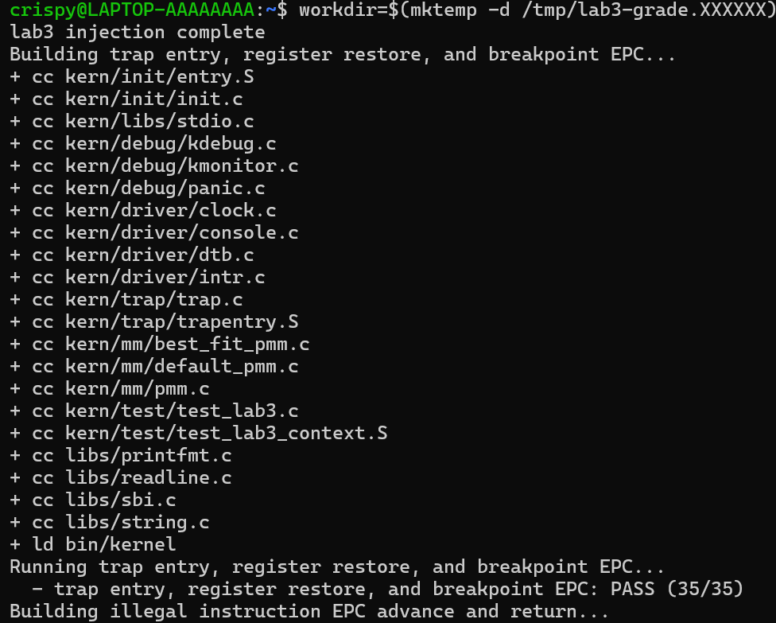
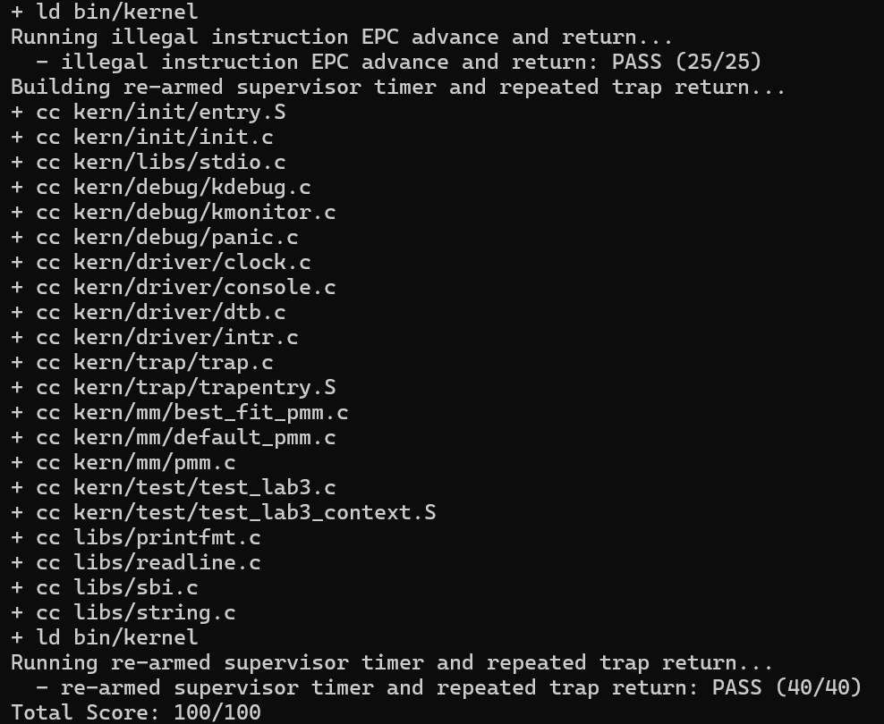

# 操作系统实验报告

## 实验基本信息

| 项目 | 内容 |
| --- | --- |
| 实验名称 | Lab 3：断，都可以断 |
| 小组成员 | 2411795-阎科霖、2411294-王烨、2411276-林靖然 |
| 完成日期 | 2026-11-04 |

### 小组分工

| 成员 | 分工 |
| --- | --- | --- |
| 2411795-阎科霖 | 功能模块一：Trap 上下文恢复与 Trap 入口功能 |
| 2411294-王烨 | 功能模块二：中断功能，衔接 Lab2 内存管理代码 | 
| 2411276-林靖然 | 功能模块二：异常处理功能 |

---

## 一、实验目的

本实验将学到：
1. riscv 的中断相关知识
2. 中断前后如何进行上下文环境的保存与恢复
3. 处理最简单的断点中断和时钟中断

---

## 二、实验环境

### 2.1 使用的 AI 工具

| 成员 | AI 编程工具 | 底层模型 |
|------|------------|---------|
| 2411276-林靖然 | Codex | GPT-6 |
| 2411294-王烨 | ChatGLM | GLM-5.3 |
| 2411795-阎科霖 | Codex | GPT-6 |

### 2.2 编译与运行环境

| 项目 | 环境 |
| ---- | ---- |
| 操作系统 | WSL2 Ubuntu 24.04 LTS |
| 目标架构 | riscv64 |
| 编译工具 | RISC-V 交叉编译工具链 |
| 虚拟机 | QEMU 4.1.1 |

---

## 三、实验整体逻辑分析

### 3.1 从事件发生到恢复执行

Lab2 已建立内核的内存管理基础。Lab3 要解决的是：当内核正在执行时，如何响应定时器或当前指令产生的异常，并在处理后保持原程序的寄存器与栈状态。

```text
初始化：清零 BSS、读取 DTB、初始化控制台和物理内存
    → idt_init() 设置 stvec 指向 __alltraps
    → clock_init() 允许 S 模式时钟中断并设置第一次到期时间
    → intr_enable() 设置 sstatus.SIE

发生已交给 S 模式处理的 Trap
    → 硬件记录 sepc、scause、stval，并更新 sstatus
    → __alltraps / SAVE_ALL 把寄存器现场保存到内核栈
    → a0 = sp，调用 trap(tf)
    → trap_dispatch() 根据 scause 最高位分派
        ├─ interrupt_handler()：重设时钟、计数、输出、关机
        └─ exception_handler()：识别异常、输出并更新 epc
    → __trapret / RESTORE_ALL 恢复现场
    → sret 继续执行
```

硬件记录返回所需的少量状态，但不会自动把所有通用寄存器压入栈。汇编入口必须先保存这些寄存器，才能调用可能改写参数和临时寄存器的 C 函数。C 层使用的 `tf` 是这份现场的地址，修改 `tf->epc` 会影响稍后的返回位置。当前 `kern_init()` 在 `pmm_init()` 前后各调用一次 `idt_init()`，之后才初始化时钟并开放全局中断。

### 3.2 功能实现的依赖顺序

1. **先建立入口与返回。** 对照保存布局补全恢复逻辑，保证 C 函数可以接收现场，并能安全返回；否则即使正确识别事件，也无法继续执行。
2. **再完成中断处理。** 由统一入口分派到时钟分支，重设下一次事件并计数，检验多次进入与退出是否稳定。
3. **补充异常恢复策略。** 非法指令和断点由当前指令同步触发，需要根据指令长度跳过触发点；时钟中断则保持原 `epc`。
4. **进行整机验证。** 把实际汇编、处理函数、初始化和 Lab2 内存管理一起构建，分别检查单次异常返回与持续时钟。

---

## 四、实验内容与实现

### 4.1 功能模块一：Trap 上下文恢复与入口

**负责人：** 2411795-阎科霖。

#### 4.1.1 实现目标与整体流程

本部分完成 Trap 处理过程中汇编层的入口和返回功能。处理器发生 Trap 时会记录 `sepc`、`scause` 等状态，但不会自动把所有通用寄存器压入内存。因此，在调用 C 语言处理函数之前，需要先保存被打断程序的寄存器；C 语言处理结束后，再根据保存的现场恢复执行。

框架已经给出了 `SAVE_ALL` 和 `struct trapframe`。本次在 `code/kern/trap/trapentry.S` 中补全 `RESTORE_ALL` 与 `__alltraps`，使执行过程形成以下闭环：

```text
发生 Trap，跳到 stvec 指向的 __alltraps
    → SAVE_ALL 将现场保存到当前栈上的 Trap frame
    → 将 Trap frame 地址作为参数传给 trap()
    → C 层完成处理并返回
    → __trapret 执行 RESTORE_ALL
    → sret 恢复执行位置、特权级和中断使能状态
```

#### 4.1.2 Trap frame 的实际布局

本工程的 `struct pushregs` 按 `x0` 到 `x31` 的顺序保存通用寄存器，随后是四个与 Trap 有关的状态字段。RV64 环境中 `uintptr_t` 和 `REGBYTES` 都是 8 字节，整个 `struct trapframe` 的大小为 `36 × 8 = 288` 字节。隔离测试通过编译期断言和运行时指针检查核对了这一布局。

| 字段 | 槽位 | 相对 Trap frame 起点的字节偏移 |
| --- | --- | --- |
| `x0` | 0 | 0 |
| `ra` | 1 | 8 |
| 原始 `sp` | 2 | 16 |
| `gp`、`tp` | 3、4 | 24、32 |
| `t0`—`t2` | 5—7 | 40—56 |
| `s0`、`s1` | 8、9 | 64、72 |
| `a0`—`a7` | 10—17 | 80—136 |
| `s2`—`s11` | 18—27 | 144—216 |
| `t3`—`t6` | 28—31 | 224—248 |
| `status`，保存 `sstatus` | 32 | 256 |
| `epc`，保存 `sepc` | 33 | 264 |
| `badvaddr` | 34 | 272 |
| `cause`，保存 `scause` | 35 | 280 |

`sp` 是这里需要特别注意的寄存器。进入 `SAVE_ALL` 后，框架先将原始 `sp` 写入 `sscratch`，再向低地址分配 288 字节，之后将原始 `sp` 保存到第 2 个槽位。因此，恢复 `sp` 时应读取这个槽位，而不是把当前 Trap frame 的起始地址当作原来的栈顶。

#### 4.1.3 关键代码与实现说明

##### 4.1.3.1 将 Trap frame 传给 C 层

入口处的实际修改为：

```asm
__alltraps:
    SAVE_ALL

    #lab3 function1 2411795
    mv a0, sp
    call trap
    # sp must still point to the same trapframe after trap returns.
```

`SAVE_ALL` 执行完成后，`sp` 指向完整的 Trap frame。RISC-V 调用约定使用 `a0` 传递第一个参数，因此通过 `mv a0, sp`，就能让 `trap(struct trapframe *tf)` 接收到当前现场的地址。调用产生的新 `ra` 不会覆盖被打断程序原来的 `ra`，因为旧值已经保存在 Trap frame 的第 1 个槽位中。

`trap()` 返回时，调用约定要求恢复它自己的栈空间，使 `sp` 回到调用前的 Trap frame 起点。执行流随后落入原有的 `__trapret`。

##### 4.1.3.2 恢复现场

`RESTORE_ALL` 的完整实现为：

```asm
    .macro RESTORE_ALL

    #lab3 function1 2411795
    # Restore the return CSRs before reloading the temporary registers.
    LOAD s0, 32*REGBYTES(sp)
    LOAD s1, 33*REGBYTES(sp)
    csrw sstatus, s0
    csrw sepc, s1

    LOAD x1, 1*REGBYTES(sp)
    LOAD x3, 3*REGBYTES(sp)
    LOAD x4, 4*REGBYTES(sp)
    LOAD x5, 5*REGBYTES(sp)
    LOAD x6, 6*REGBYTES(sp)
    LOAD x7, 7*REGBYTES(sp)
    LOAD x8, 8*REGBYTES(sp)
    LOAD x9, 9*REGBYTES(sp)
    LOAD x10, 10*REGBYTES(sp)
    LOAD x11, 11*REGBYTES(sp)
    LOAD x12, 12*REGBYTES(sp)
    LOAD x13, 13*REGBYTES(sp)
    LOAD x14, 14*REGBYTES(sp)
    LOAD x15, 15*REGBYTES(sp)
    LOAD x16, 16*REGBYTES(sp)
    LOAD x17, 17*REGBYTES(sp)
    LOAD x18, 18*REGBYTES(sp)
    LOAD x19, 19*REGBYTES(sp)
    LOAD x20, 20*REGBYTES(sp)
    LOAD x21, 21*REGBYTES(sp)
    LOAD x22, 22*REGBYTES(sp)
    LOAD x23, 23*REGBYTES(sp)
    LOAD x24, 24*REGBYTES(sp)
    LOAD x25, 25*REGBYTES(sp)
    LOAD x26, 26*REGBYTES(sp)
    LOAD x27, 27*REGBYTES(sp)
    LOAD x28, 28*REGBYTES(sp)
    LOAD x29, 29*REGBYTES(sp)
    LOAD x30, 30*REGBYTES(sp)
    LOAD x31, 31*REGBYTES(sp)

    # Keep the trapframe base until every other register has been restored.
    LOAD x2, 2*REGBYTES(sp)

    .endm
```

先恢复 `sstatus` 和 `sepc`，再恢复通用寄存器，是因为读取 CSR 保存值时使用了 `s0`、`s1` 作为临时寄存器。这两个临时值使用结束后，仍需从第 8、9 个槽位恢复原来的 `s0`、`s1`。

`x0` 的值固定为零，不需要执行恢复写入。`sp` 则最后恢复，保证前面的所有加载都使用同一个 Trap frame 起点。第 34、35 个槽位用于记录异常附加信息和原因，本次没有把它们回写到 CSR；Trap 返回所需的状态来自 `status`、`epc` 和通用寄存器保存区。

最终使用框架原有的返回代码：

```asm
__trapret:
    RESTORE_ALL
    # return from supervisor call
    sret
```

`sret` 根据保存的 `SPP` 决定返回的特权级，并将 `sepc` 交给程序计数器。本次测试从 S 模式触发 Trap，验证的是返回 S 模式继续执行。标准规定 `SIE` 从 `SPIE` 恢复，随后 `SPIE` 置 1、`SPP` 清零。

#### 4.1.4 编译与运行验证

##### 4.1.4.1 验证环境

本轮实测环境为 WSL Ubuntu 22.04、RISC-V GCC 15.1.0、QEMU 6.2.0，使用本机已安装的 OpenSBI v0.4 `opensbi-riscv64-virt-fw_jump.bin` 固件，配置为 `virt`、单 hart、128 MiB 内存，raw 镜像加载地址为 `0x80200000`。工具版本、命令和固件摘要保存在 [最终验证记录](a_trap_evidence/20261028_A_publish/results.json) 中。

##### 4.1.4.2 独立验证方法

由于后面的函数还没完成，所以当前原树不能完整编译。因此先验证 `trapentry.S` 汇编对象能够正常生成，再由 `tools/run_a_trap_checks.py` 在临时副本中构建验证内核。

临时副本保留原启动汇编、页表映射、控制台、实际 `trapentry.S` 和 `trap.h`，跳过尚未完成的 PMM，并用专门的测试入口替代未完成的 C 层分发尾部。该入口只检查保存现场、设置已知的返回地址，并在返回前刻意改写除 `sp` 之外的通用寄存器，使恢复过程必须从 Trap frame 重新加载正确值。用于返回的临时寄存器同样会失去原值，因此也受到恢复检查。

| 检查 | 实际覆盖 | 结果 |
| --- | --- | --- |
| 汇编对象编译 | RV64 汇编、CSR 编码、入口与返回指令 | 通过 |
| 第 1 组 | 32 位断点、全部 GPR 槽位、Trap frame 地址与对齐、`SIE=0` 返回 | 通过 |
| 第 2 组 | 16 位压缩断点、全部 GPR 槽位、`SIE=1` 返回 | 通过 |
| 第 3 组 | 修改保存的 `a0`、重定向 `epc`、修改 `SPIE` 后恢复 `SIE` | 通过 |
| 第 4 组 | 交替执行 256 次断点 Trap，逐次核对寄存器和栈位置 | 通过 |
| 空实现对照 | 保留名称兼容映射，将两处实现还原为空 | 未产生成功标记，4 秒超时，按预期检出 |
| 错误偏移对照 | 故意从第 11 个槽位恢复 `a0` | 报告寄存器 10 恢复错误，按预期检出 |

四组正常运行累计完成 **259 次 Trap**。原始成功日志为：

```text
A_TRAP_CASE1 PASS 32-bit breakpoint, all GPRs, SIE=0
A_TRAP_CASE2 PASS 16-bit breakpoint, all GPRs, SIE=1
A_TRAP_CASE3 PASS edited a0, epc redirection, SPIE -> SIE
A_TRAP_CASE4 PASS 256 repeated traps, stable stack
A_TRAP_ALL_PASS cases=4 traps=259
```

#### 4.1.5 结论

本部分完成了现有内核栈上 Trap frame 的传参、恢复和返回。验证说明当前实现能够保存并恢复测试中的通用寄存器，使用 C 层更新后的返回状态，并在重复 Trap 后保持栈位置稳定。


### 4.2 功能模块二：中断与异常处理

统一分发函数根据 `(intptr_t)tf->cause < 0` 判断最高位：最高位为 1 进入中断处理，否则进入异常处理。

#### 4.2.1 中断分类与时钟处理

**负责人：** 2411294-王烨。

```c
void interrupt_handler(struct trapframe *tf);
```

**规格设计：** 输入为有效 Trap frame。对中断先去除 `scause` 最高位标志，再按原因号分类；时钟分支重设下一次事件，每次将 `ticks` 加一，每满 `TICK_NUM=100` 输出一次 `100 ticks`，输出累计达到 `SHUTDOWN_AFTER=10` 后调用 `sbi_shutdown()`。其他已列出的原因输出类型提示，未知原因输出原因号与完整现场。时钟分支不修改 `tf->epc`。

代码用 `(tf->cause << 1) >> 1` 去掉最高位。`tf->cause` 为无符号的 `uintptr_t`，先完成逻辑移位，再赋给 `intptr_t`。`switch` 中的软件、定时器、外部中断分支按框架常量区分；列出某类原因只表示提供分类输出，不表示本内核已经实现相应模式或外设驱动。

时钟分支的核心代码为：

```c
case IRQ_S_TIMER:
    clock_set_next_event();
    if (++ticks % TICK_NUM == 0) {
        print_ticks();
        num++;
    }
    if (num == SHUTDOWN_AFTER) {
        sbi_shutdown();
    }
    break;
```

`ticks` 记录收到的时钟中断次数，`num` 记录打印次数。普通构建从零开始时，第 1000 次时钟中断打印第十行，再请求关机。框架的 `print_ticks()` 在定义 `DEBUG_GRADE` 时还会执行提前结束路径；上述十次输出描述的是未定义该宏的普通运行。

`clock_set_next_event()` 调用 `sbi_set_timer(get_cycles() + timebase)`。虽然辅助函数名为 `get_cycles()`，实际 RV64 代码执行的是 `rdtime`，读的是时间计数器。`timebase=100000` 表示计数增量；在指导书采用的 10 MHz 时间基准下，名义间隔为 10 ms，100 次约 1 秒。每次按当前时间重新设置，处理开销可能累积，不能将十次输出严格等同于十秒墙钟时间。

**最终提示词：**

```text
[PROMPT]
在 trap.c 实现 interrupt_handler(tf)，学号 2411294 王烨。
仅完成本人中断处理部分，不修改其他成员的汇编和异常逻辑。

[RELY]
读取 trap.c、trap.h、clock.c/h、riscv.h、sbi.h/c，
以框架的中断原因、ticks、TICK_NUM、SHUTDOWN_AFTER 和接口为准。

[GUARANTEE]
保留函数签名、trap_dispatch()、print_ticks() 与现场布局。
其他已知中断输出对应提示，未知中断输出原因号并 print_trapframe(tf)。

[SPECIFICATION]
去除 cause 的最高中断标志后分派。
IRQ_S_TIMER 每次先设置下一次时钟事件，再将 ticks 加一；
每累计 100 次调用 print_ticks()，将打印计数加一；
打印满 10 次调用 sbi_shutdown()。不修改时钟中断的 epc。
通过整机测试确认中断能持续发生，普通运行十次输出后关机。
```

#### 4.2.2 非法指令与断点异常

**负责人：** 2411276-林靖然。

```c
void exception_handler(struct trapframe *tf);
```

**规格设计：** 对非法指令打印 `Illegal instruction at 0x%08x`，对断点打印 `Breakpoint at 0x%08x`，其中地址使用处理前的 `tf->epc`。两种情况处理后都按指令长度更新 `epc`，其他异常仅调用 `print_trapframe(tf)`。本实验预期异常位于可读取的内核指令地址。

当前实现的两个分支分别使用以下逻辑：

```c
tf->epc += ((*(uint16_t *)tf->epc & 0x3) == 0x3) ? 4 : 2;
```

读取起始半字的最低两位：不为 `11` 的编码按 16 位压缩指令跳过，为 `11` 的编码在本实验的 16/32 位指令范围内按 4 字节跳过。这样可以处理压缩断点和普通断点，也能越过测试中的 `.word 0x0000007b` 非法指令。

如果不更新 `epc`，`sret` 将再次执行原指令，导致异常重复发生；若统一加 4，16 位指令后的下一条指令可能被跳过；若统一加 2，则会返回到 32 位指令的中间。读取半字也避免为判断长度先执行一次可能未按 4 字节对齐的整字读取。

### 4.3 中断使能与原子性分析

指导书最后一节讨论中断开关和原子操作，并提出 `do { ... } while (0)` 的作用。

`intr_enable()` 设置 `sstatus.SIE`，`intr_disable()` 清除该位；`clock_init()` 还需设置 `sie` 中对应时钟源的使能位。两者分别控制 S 模式全局响应条件和具体来源。

`alloc_pages()`、`free_pages()`、`nr_free_pages()` 在调用 PMM 前使用 `local_intr_save(intr_flag)`，之后恢复原状态。保存状态的目的，是避免原先已经关闭中断的调用者在退出内存管理函数时被意外开启中断。嵌套使用时各层须保存自己的标志，并按进入顺序的逆序恢复。

`do { ... } while (0)` 使宏展开后表现为一条语句，调用者可以正常在结尾加分号，也可安全放入 `if/else`，循环体只执行一次。

---

## 五、测试与验证

### 5.1 验证方法与证据

测试在 WSL 临时副本中进行：复制 `code/`，运行原有 `tools/inject.py`，再执行原有 `tools/grade.sh`。这与 `make grade` 使用相同的注入器和评分脚本。

```bash
# 创建临时目录并复制代码
workdir=$(mktemp -d /tmp/lab3-grade.XXXXXX)
cp -a ~/os_homework/code/. "$workdir/"

# 进入副本并运行评分
cd "$workdir"
make grade
```

运行结果如图所示，通过了所有评分脚本：



### 5.2 评分结果

| 评分项目 | 实际检查内容 | 结果 |
| --- | --- | --- |
| Trap 入口、寄存器恢复与断点返回 | 设置多组寄存器值，触发 `ebreak`，返回后检查保存值并继续执行 | 35/35 |
| 非法指令返回及兜底处理 | 执行 32 位非法指令后继续，检查软件中断提示、未知中断和未知异常现场输出 | 25/25 |
| 持续 S 模式时钟 | 等待 `ticks` 达到 200，检查重复输出 `100 ticks` 及成功标记 | 40/40 |
| 合计 | 三个配置分别重新构建并运行 | **100/100** |

评分脚本实际输出摘要：

```text
  - trap entry, register restore, and breakpoint EPC: PASS (35/35)
  - illegal instruction EPC advance and return: PASS (25/25)
  - re-armed supervisor timer and repeated trap return: PASS (40/40)
Total Score: 100/100
```


### 5.3 普通运行与关机

QEMU 输出初始化信息和十行 `100 ticks` 后正常退出，退出码为 0，未触发 18 秒超时。这与代码中每 100 次中断打印、打印十次后调用 `sbi_shutdown()` 的路径一致。

```text
++ setup timer interrupts
100 ticks
100 ticks
100 ticks
100 ticks
100 ticks
100 ticks
100 ticks
100 ticks
100 ticks
100 ticks
```

该结果同时检验了首次定时器设置、每次中断后重设事件、多次现场恢复，以及最终关机路径。

---

## 六、实验总结与收获

### 6.1 重要知识点及与 OS 原理的联系

| 实验中的机制 | 对应 OS 原理 | 含义、联系与区别 |
| --- | --- | --- |
| `scause` 与统一分发 | 同步异常和异步中断 | 异常由当前指令触发，中断由定时器等事件异步到来；RISC-V 用 Trap 统称二者。`ebreak` 属于异常，不能与软件中断原因号混用。 |
| S 模式内核与 OpenSBI | 特权级及软硬件接口 | 内核运行在 S 模式，借助 SBI 请求定时器与关机服务；哪些事件交给 S 模式还取决于委托配置。Trap 不一定提升特权级，本实验主要观察 S→S。 |
| `stvec`、`__alltraps` | 中断入口与向量机制 | `stvec` 指定入口，本实验以对齐入口地址使用 Direct 模式，再在软件中分派；没有为各原因建立独立向量入口。 |
| `SAVE_ALL`、Trap frame | 上下文保存 | 硬件记录少量 CSR，软件保存 GPR；保存区同时服务于恢复和诊断。发生 Trap 不自动意味着发生进程切换。 |
| `a0=sp`、`call trap` | 函数调用约定 | 汇编和 C 通过约定共享参数与栈。异步入口需要保护被打断程序的完整整数现场，不能只按普通函数的 callee-saved 规则保存。 |
| `RESTORE_ALL`、`sret` | 异常返回与状态恢复 | 软件将可修改的现场装回寄存器和返回 CSR，硬件指令完成返回。C 函数的普通 `ret` 只回到汇编入口，不能代替 `sret`。 |
| 按长度更新 `epc` | 异常恢复策略 | 断点、非法指令在本实验中选择跳过；时钟保留原位置。真实缺页处理常在补齐映射后重试，不能把“统一跳过”推广到所有异常。 |
| 定时器重设、`ticks` | 时钟驱动与时间记账 | 一次到期设置只提供一个事件，软件重设后才形成持续中断；有计数仍不等于实现调度器，时间基准也不等于 CPU 主频。 |
| 保存中断状态、AMO | 临界区与原子性 | 本地屏蔽中断和单项原子读改写各有保护范围；二者都不能自动提供任意多步、多核操作所需的全部同步。 |

### 6.2 本实验尚未对应的原理知识

- **进程调度与完整上下文切换：** 时钟可以提供调度机会，但当前只有内核循环，没有就绪队列、时间片选择或任务切换。
- **用户态、系统调用与隔离：** 当前没有用户进程和系统调用分发，也没有建立用户栈与内核栈的切换协议。
- **缺页恢复与虚拟内存策略：** 未知异常只打印现场，没有按需分页、权限修复或页面置换。
- **外部中断控制器与设备驱动：** 外部中断分支只有类型提示，没有设备识别、请求确认和 I/O 完成处理。

### 6.3 实验收获

通过这次实验，我们了解了中断发生后保存现场，进入处理函数再恢复执行的完整过程。栈指针的恢复顺序、异常后返回地址的调整，都是调试时需要仔细核对的地方。通过对照汇编和 C 代码，我们对寄存器保存在哪里，处理函数如何修改返回地址，最后怎样恢复现场有了具体的认识。